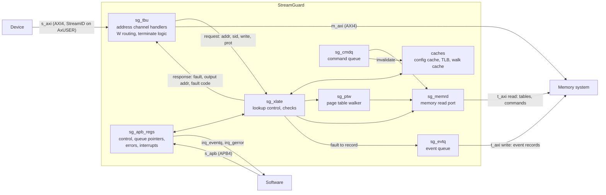
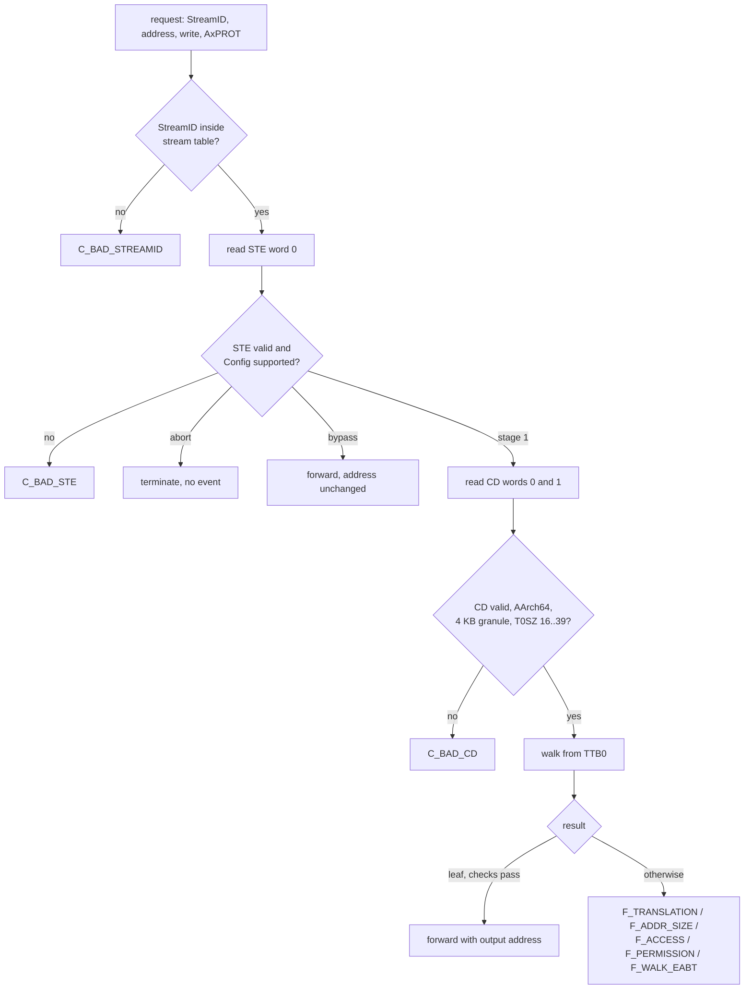
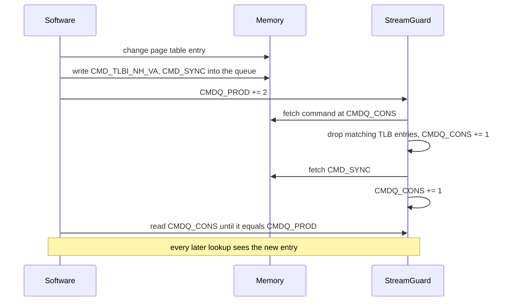

# StreamGuard architecture

## 1. What it does

A device that can issue its own memory accesses (a DMA-capable accelerator,
for example) is a risk: a wrong or malicious address reaches any memory on the
bus. StreamGuard is placed in-line on the device's AXI4 link. Each access is
tagged with a StreamID identifying the device. StreamGuard looks up that
stream's configuration, translates the address through that stream's page
tables, checks permissions, and either forwards the access with the translated
address or terminates it and records a fault.

This is the job of a System MMU. StreamGuard follows the public Arm SMMUv3
architecture specification (IHI 0070) for its programming model so that the
concepts carry over, and implements a deliberately small subset.

## 2. Block diagram

The split mirrors how production SMMUs are organised: a translation buffer
unit in the data path, and control logic that owns the configuration, reads
the tables from memory through its own port and answers translation requests.

## 3. Interfaces

| Port group | Protocol | Direction | Purpose |
|---|---|---|---|
| `s_axi_*` | AXI4, StreamID on `awuser`/`aruser` | from device | accesses to be policed |
| `m_axi_*` | AXI4 | to memory | forwarded accesses |
| `t_axi_*` | AXI4, 64-bit data | to memory | the unit's own accesses: stream table, context descriptor, translation table and command reads; event record writes |
| `irq_eventq`, `irq_gerror` | one cycle pulses | to interrupt controller | event queue went from empty to not empty; a global error became active |
| `s_apb_*` | APB4, 17-bit address | from software | registers |

Parameters: `ADDR_W` (48), `DATA_W` (64), `ID_W` (4), `SID_W` (8),
`TLB_ENTRIES` (8), `WC_ENTRIES` (4), `CFG_ENTRIES` (4), `TLB_POLICY` (0: round
robin, 1: not recently used). The cache sizes and the policy were studied in
[the sizing study](sizing_study.md).
Reset is active low, asserted asynchronously.

## 4. Datapath behaviour

| SMMUEN | GBPA.ABORT | Result |
|---|---|---|
| 0 | 0 | bypass: address and all AXI attributes forwarded unchanged |
| 0 | 1 | terminate: SLVERR to the device, nothing reaches downstream |
| 1 | x | per-stream lookup, see section 5 |

### 4.1 Address channels

`sg_addr_chan` handles one request at a time: accept, ask for a decision, then
forward downstream or hand to the terminate logic. AW and AR share the single
translation port through a round robin arbiter.

### 4.2 Write data

AXI4 allows W beats to arrive before their AW. W therefore cannot be passed
straight through, because the decision for that burst may not exist yet. Each
AW decision is pushed into a small queue. A W burst is consumed only when its
decision is at the head: forwarded for a pass, dropped for a terminate.

### 4.3 Terminate and response ordering

AXI requires responses with the same ID to return in the order the requests
were issued. A locally generated error response is ready immediately, so it
could overtake the response of an earlier transaction with the same ID that
is still in flight downstream.

StreamGuard avoids this without tracking IDs. A terminated transaction

1. blocks new requests on its channel until its response has been sent, and
2. sends its response only when nothing is outstanding downstream.

Because of (1) nothing younger can exist, and because of (2) nothing older is
still pending, so the error response is always in order. The cost is
throughput while a termination is in progress, which is acceptable because
terminations are the exception.

## 5. Translation lookup

With SMMUEN set, every address request is looked up. The flow below is the
full lookup, done when nothing useful is cached; section 5.4 describes the
caches that let most requests skip some or all of it.

Every fault terminates the transaction with SLVERR. The fault code (the
SMMUv3 event number) and level are reported next to the response and will be
written to the event queue in a later milestone.

### 5.1 Structures read from memory

| Structure | Located by | Words read | Fields used |
|---|---|---|---|
| Stream Table Entry (64 bytes) | STRTAB_BASE + StreamID x 64 | word 0 | V, Config, S1Fmt, S1ContextPtr |
| Context Descriptor (64 bytes) | STE.S1ContextPtr | words 0 and 1 | T0SZ, TG0, EPD0, ENDI, V, AFFD, AA64, TTB0 |
| Translation table descriptor (8 bytes) | table base + index x 8 | one per level | valid, type, output/next address, AP, AF, PXN, UXN |

### 5.2 Table walk

AArch64 stage 1 format, 4 KB granule, TTB0 region only.

| Level | Index bits | One entry maps | May be |
|---|---|---|---|
| 0 | VA[47:39] | 512 GB | table |
| 1 | VA[38:30] | 1 GB | table or block |
| 2 | VA[29:21] | 2 MB | table or block |
| 3 | VA[20:12] | 4 KB | page |

T0SZ gives the input address size (2^(64-T0SZ)) and so the starting level:
16 to 24 starts at level 0, 25 to 33 at level 1, 34 to 39 at level 2.

Checks at each descriptor, in priority order: external abort on the read,
invalid or reserved encoding (translation fault), address bits above the
48-bit output size (address size fault), then for a leaf the access flag and
permissions. Permission inputs are the direction of the access and AxPROT:
write to a read-only mapping, unprivileged access without AP[1], or an
instruction read from an execute-never mapping.

An AXI burst cannot cross a 4 KB boundary, so translating the start address
of a burst covers all of its beats.

### 5.3 Cost of a lookup

Measured in simulation, request accepted to request forwarded, with a memory
that answers without stalling:

| Case | Table reads | Cycles, milestone 2 (no caches) | Cycles, milestone 3 |
|---|---|---|---|
| TLB hit | 0 | - | 4 |
| Walk cache hit (config cached, other page in the same 2 MB region) | 1 | - | 12 |
| STE bypass, configuration not cached | 1 | 9 | 10 |
| 1 GB block, nothing cached | 4 | 30 | 32 |
| 4 KB page, nothing cached | 6 | 42 | 44 |

A lookup that misses everything costs 2 cycles more than before: one for the
cache lookup and one to try the TLB again once the configuration is known.

### 5.4 Caches

Three small, fully associative caches sit in front of the memory reads:

| Cache | Tag | Holds | Entries (default) | Saves |
|---|---|---|---|---|
| Configuration cache | StreamID | kind (abort, bypass, stage 1), ASID, T0SZ, AFFD, TTB0 | 4 | STE and CD reads |
| TLB | ASID, VA (masked by the entry's level) | output address, level, AP[2:1], PXN, UXN | 8 | the whole walk |
| Walk cache | ASID, VA[47:21] | address of the level 3 table | 4 | levels 0 to 2 of a walk |

Lookup order: configuration (cache, or STE and CD from memory), then TLB with
that configuration's ASID, then on a miss a walk that starts at level 3 when
the walk cache hits.

**What is cached.** Only results that did not fault, with one exception: a leaf
that failed only the permission check is cached, because permissions are
checked again on every hit against the access that hits. Translation, address
size and access flag faults are not cached, so software that fixes such an
entry does not have to invalidate. Configuration errors are not cached either.

**Block entries.** A TLB entry records its level. A 2 MB entry compares
VA[47:21] and takes VA[20:0] from the input; a 1 GB entry compares VA[47:30].

**ASIDs.** TLB and walk cache entries are tagged with the ASID from the context
descriptor, not with the StreamID. Two streams whose descriptors give the same
ASID share entries, which is the architected meaning of an ASID: software must
give separate address spaces separate ASIDs.

**Replacement.** An entry holding the same translation is overwritten,
otherwise the first empty entry is used, otherwise the policy chooses. The walk
cache and configuration cache use round robin. The TLB has two policies,
selected by `TLB_POLICY`:

- **Round robin**: entries are replaced in turn, used or not.
- **Not recently used (NRU)**: one bit per entry, set when the entry is filled
  or when a lookup uses a hit on it. When setting a bit would set them all,
  the others are cleared instead. The victim is the lowest numbered entry
  whose bit is clear, so an entry hit since the last clear is never replaced.
  The logic is only built when selected; it costs one flip-flop per entry
  and a priority encoder.

The sizing study found NRU equal or better on every workload from 8 entries
up, at a cost of 5 flip-flops in the default size. The default stays round
robin so that earlier results remain reproducible; `TLB_POLICY=1` is the
recommended setting.

**Invalidation.** The architected way is the command queue (section 6): TLBI
commands for the TLB and walk cache, CFGI commands for the configuration
cache. Writing SG_INV.ALL clears all three caches at once and is kept as a
debug aid. If that write arrives while a lookup is in progress, the lookup may
hold table data read before the software change, so it finishes but fills
nothing. Commands cannot arrive mid-lookup at all, see 6.1.

**Disable.** SG_CTRL.CACHE_DIS makes every lookup miss and stops all fills, so
the unit behaves exactly as milestone 2 did. The tests use it to check exact
read counts.

**Counters.** TLB hits and misses, walk cache hits, configuration cache hits
and misses, counted per lookup and cleared by SG_INV.COUNTERS.

## 6. Queues

Software and the unit exchange work through two circular buffers in memory,
as in SMMUv3. Each has 2^LOG2SIZE entries (at most 16), a base register and
two pointer registers. A pointer holds an index and one wrap bit above it:
the queue is empty when both pointers are equal, and full when the indexes
are equal and the wrap bits differ.

| Queue | Entry | Written by | PROD moved by | CONS moved by |
|---|---|---|---|---|
| Command queue | 16 bytes | software | software | hardware |
| Event queue | 32 bytes | hardware | hardware | software |

### 6.1 Command queue

| Opcode | Command | Effect |
|---|---|---|
| 0x01, 0x02 | CMD_PREFETCH_CONFIG, CMD_PREFETCH_ADDR | none (prefetch is optional) |
| 0x03 | CMD_CFGI_STE | drop the cached configuration of one StreamID |
| 0x04 | CMD_CFGI_STE_RANGE | the same for 2^(Range+1) StreamIDs; Range = 31 is CFGI_ALL |
| 0x05, 0x06 | CMD_CFGI_CD, CMD_CFGI_CD_ALL | as CFGI_STE (one context descriptor per stream) |
| 0x10, 0x30 | CMD_TLBI_NH_ALL, CMD_TLBI_NSNH_ALL | drop every TLB and walk cache entry |
| 0x11 | CMD_TLBI_NH_ASID | drop those of one ASID |
| 0x12 | CMD_TLBI_NH_VA | drop those of one ASID that cover one address |
| 0x13 | CMD_TLBI_NH_VAA | drop those of any ASID that cover one address |
| 0x46 | CMD_SYNC | none: everything before it has already taken effect |

**Covering an address.** A TLB entry is compared using its own level, so an
address anywhere inside a 2 MB or 1 GB block removes the block's entry.

**Leaf.** TLBI_NH_VA and TLBI_NH_VAA with Leaf = 1 remove only leaf (TLB)
entries. With Leaf = 0 the walk cache entry for that 2 MB region goes too,
which is what software needs after changing a table pointer.

**What is not touched.** TLBI commands leave the configuration cache alone,
and CFGI commands leave the TLB alone. After a CFGI the next access reads the
STE and CD again and can still hit the TLB.

**Ordering with lookups.** A command runs only while no lookup is in progress,
and a waiting command goes before the next request. The command fetch shares
the memory read port with the table reads, so this costs no extra hardware and
gives a simple guarantee: an invalidation never lands in the middle of a
lookup, and once software sees CMD_SYNC consumed, every later lookup uses the
new state. An access that was translated before the command still completes
with the old translation.

**Errors.** An opcode outside the table stops the queue: CMDQ_CONS stays on the
command, CMDQ_CONS.ERR is set to CERROR_ILL and GERROR.CMDQ_ERR toggles. A bus
error on the fetch does the same with CERROR_ABT. Software repairs the entry
and toggles GERRORN.CMDQ_ERR to match; processing resumes from the same slot.

### 6.2 Event queue

A fault that is recorded is written before the response is given, as one
4-beat write:

| Word | Contents |
|---|---|
| 0 | [7:0] event number, [63:32] StreamID |
| 1 | translation-related faults only: [35] RnW, [34] InD, [33] PnU |
| 2 | translation-related faults only: input address |
| 3 | zero |

| Outcome | Recorded |
|---|---|
| GBPA abort, STE.Config = abort | never |
| C_BAD_STREAMID, C_BAD_STE, C_BAD_CD, fetch aborts, F_WALK_EABT | always |
| F_TRANSLATION, F_ADDR_SIZE, F_ACCESS, F_PERMISSION | when CD.R = 1 |

CD.R is kept in the configuration cache, so a permission fault raised from a
TLB hit follows the same rule as one raised by a walk.

**Full queue.** The record is dropped and EVENTQ_PROD.OVFLG toggles. Software
acknowledges by writing the same value to EVENTQ_CONS.OVACKFLG. Further losses
before the acknowledge do not toggle the flag again.

**Disabled queue.** With CR0.EVENTQEN = 0 nothing is written.

Recording never changes what happens to the access: it is terminated with
SLVERR whether or not the record could be stored.

**Interrupts.** `irq_eventq` pulses when a record is written into an empty
queue and IRQ_CTRL.EVENTQ_IRQEN is set. `irq_gerror` pulses when a GERROR bit
becomes active and IRQ_CTRL.GERROR_IRQEN is set.

## 7. Register map

Offsets follow the SMMUv3 register map (IHI 0070, chapter 6). Unlisted offsets
read as zero and ignore writes.

| Offset | Name | Access | Implemented fields |
|---|---|---|---|
| 0x0000 | IDR0 | RO | S1P, TTF, TTENDIAN, STALL_MODEL, ST_LEVEL |
| 0x0004 | IDR1 | RO | SIDSIZE, EVENTQS, CMDQS |
| 0x0014 | IDR5 | RO | OAS, GRAN4K |
| 0x0020 | CR0 | RW | SMMUEN [0], EVENTQEN [2], CMDQEN [3] |
| 0x0024 | CR0ACK | RO | mirrors CR0 one cycle later |
| 0x0044 | GBPA | RW | ABORT [20], UPDATE [31] |
| 0x0050 | IRQ_CTRL | RW | GERROR_IRQEN [0], EVENTQ_IRQEN [2] |
| 0x0054 | IRQ_CTRLACK | RO | mirrors IRQ_CTRL one cycle later |
| 0x0060 | GERROR | RO | CMDQ_ERR [0], EVENTQ_ABT_ERR [2]; a bit toggles on each error |
| 0x0064 | GERRORN | RW | software toggles a bit to acknowledge |
| 0x0080 | STRTAB_BASE | RW | ADDR [47:6] (64-bit register, two APB words) |
| 0x0088 | STRTAB_BASE_CFG | RW | LOG2SIZE [5:0]; format is always linear |
| 0x0090 | CMDQ_BASE | RW | LOG2SIZE [4:0], ADDR [47:5] (64-bit) |
| 0x0098 | CMDQ_PROD | RW | WR [4:0] |
| 0x009C | CMDQ_CONS | RO, RW while CMDQEN = 0 | RD [4:0], ERR [30:24] |
| 0x00A0 | EVENTQ_BASE | RW | LOG2SIZE [4:0], ADDR [47:5] (64-bit) |
| 0x100A8 | EVENTQ_PROD | RO, RW while EVENTQEN = 0 | WR [4:0], OVFLG [31] |
| 0x100AC | EVENTQ_CONS | RW | RD [4:0], OVACKFLG [31] |
| 0x0E00 | SG_CTRL | RW | CACHE_DIS [0] (StreamGuard-specific) |
| 0x0E04 | SG_INV | WO | ALL [0]: invalidate all caches; COUNTERS [1]: clear counters. Reads 0 (StreamGuard-specific) |
| 0x0E10 to 0x0E20 | SG_TLB_HIT, SG_TLB_MISS, SG_WC_HIT, SG_CFG_HIT, SG_CFG_MISS | RO | 32-bit event counters (StreamGuard-specific) |

GBPA is only changed by a write that sets UPDATE. UPDATE reads as 1 until the
new value is in effect.

A LOG2SIZE above 4 is treated as 4 (IDR1.CMDQS and IDR1.EVENTQS are 4).

### Spec cross-check

Each field encoding is checked against the specification text before it is
relied on by a later milestone.

| Item | Spec reference | Checked |
|---|---|---|
| Register offsets above | ch. 6, register map | pending |
| IDR0 / IDR1 / IDR5 field positions and encodings | ch. 6 | pending |
| CR0 / CR0ACK update procedure | ch. 6 | pending |
| GBPA UPDATE procedure, effect only while SMMUEN = 0 | ch. 6 | pending |
| STRTAB_BASE / STRTAB_BASE_CFG fields | ch. 6 | pending |
| STE word 0: V, Config encodings, S1Fmt, S1ContextPtr | ch. 5 | pending |
| CD words 0 and 1: field positions, validity rules | ch. 5 | pending |
| Event numbers used as fault codes | ch. 7 | pending |
| CD ASID field position, 8-bit ASID when IDR0.ASID16 = 0 | ch. 5 | pending |
| 0x0E00 range of page 0 free for implementation defined registers | ch. 6 | pending |
| Queue register offsets and fields; EVENTQ_PROD/CONS on page 1 | ch. 6 | pending |
| Pointer wrap bit, empty and full conditions | ch. 3 (queues) | pending |
| LOG2SIZE above IDR1.CMDQS / EVENTQS capped to the maximum | ch. 6 | pending |
| Command opcodes and field positions (StreamID, ASID, Address, Leaf, Range) | ch. 4 | pending |
| CFGI_STE_RANGE covers 2^(Range+1) StreamIDs; Range 31 = CFGI_ALL | ch. 4 | pending |
| Which commands are CERROR_ILL in a stage 1 only, no-stall implementation | ch. 4 | pending |
| CMDQ_CONS.ERR codes; CONS stays on the failing command; resume after GERRORN | ch. 4, 7 | pending |
| What CMD_SYNC guarantees about transactions already in flight | ch. 4 | pending |
| Event record layout: ID, StreamID, RnW, InD, PnU, InputAddr | ch. 7 | pending |
| CD.R gates exactly the four translation-related faults; CD.A, CD.S | ch. 5, 3 (faults) | pending |
| OVFLG / OVACKFLG behaviour; no second toggle while unacknowledged | ch. 7 | pending |
| GERROR / GERRORN toggle protocol and bit positions; IRQ_CTRL bits | ch. 6 | pending |
| Event queue interrupt condition (empty to not empty) | ch. 3 (interrupts) | pending |
| TLB and walk cache tagging by ASID; what CMD_TLBI_* invalidate | ch. 3 and 4 | pending |
| Which conditions record an event and which terminate silently | ch. 7 | pending |
| Descriptor formats, fault priority | Arm ARM, VMSAv8-64 | pending |

## 8. Design decisions

| # | Decision | Reason |
|---|---|---|
| D1 | Enabled without translation logic terminates everything | Fail closed: if an access cannot be shown to be allowed it is not forwarded |
| D2 | Terminated transactions get SLVERR, read data zero | The device must see a completed transaction with an error, and no stale data |
| D3 | Ordering by blocking instead of per-ID tracking | Small and easy to reason about; see 4.3 |
| D4 | One address request in flight per channel | Correct first. A TLB-hit fast path is a later optimisation with a measurable baseline |
| D5 | Datapath acts on CR0ACK, not CR0 | What software reads back as acknowledged is what the hardware is doing |
| D6 | APB for registers | Low-speed configuration bus, as used for the programming interface of system IP |
| D7 | Full lookup on every request before any cache exists | Gives a correct reference behaviour and a measured baseline; caching is then an optimisation that can be checked against it |
| D8 | Separate AXI read port for table fetches | Table reads must not be translated or blocked by the device's own traffic |
| D9 | Fault codes are the SMMUv3 event numbers | The event queue can store them without a mapping table |
| D10 | Only the STE and CD words that are used are read | Fewer memory reads per lookup; the unread fields are all out of scope |
| D11 | StreamID carried on AxUSER | Standard AXI sideband, so any AXI requester can drive it |
| D12 | Fully associative caches | Entries of different sizes (4 KB, 2 MB, 1 GB) can share one TLB without choosing an index per size; at 4 to 8 entries the compare logic is small |
| D13 | TLB tagged by ASID, not StreamID | Matches the architecture and lets ASID-based invalidation commands work later |
| D14 | Cache permission-faulting leaves, not other faults | Permissions are rechecked on every hit, so the entry stays correct for other access types; other faults must be seen again once software fixes the entry |
| D15 | Invalidation during a lookup cancels that lookup's fills | Otherwise data read before the software change could be cached after the invalidation and served forever |
| D16 | Cache disable bit | Exact read counts in tests, and a fallback for debugging |
| D17 | One shared lookup state for cache hits and fresh configurations | After STE and CD are read the TLB is tried again, so a configuration-only miss does not force a walk |
| D18 | Commands run only between lookups | No command/lookup race to reason about, a strong meaning for CMD_SYNC, and the memory read port is shared anyway. Cost: a request waits while a command runs |
| D19 | All register state, including the hardware-owned pointers, lives in the register block | One place for pointer arithmetic and for software/hardware write priority; the queue modules only see "pending", "full" and an index |
| D20 | The event is written before the fault response | When the device sees the error, the record is already there for the handler; costs a few cycles on the fault path only |
| D21 | Recording never changes the outcome | A full or disabled event queue must not turn a blocked access into an allowed one, or stall the bus |
| D22 | Queue stops on a bad command | Later commands may depend on it; skipping one invalidation silently would leave stale entries |
| D23 | NRU rather than true LRU as the second TLB policy | LRU needs an ordering of all entries (log2(N) bits each, or a matrix); NRU needs one bit each and still protects entries that are being used |
| D24 | Cache sizes and policy as parameters, chosen by measurement | The sizing study replays traffic through a model checked against the RTL, so the choice rests on data, not on a guess |

## 9. Scope

Implemented: stage 1 translation, AArch64 table format, 4 KB
granule with 2 MB and 1 GB blocks, linear stream table, one context
descriptor per stream, ASID-tagged TLB, command queue with invalidation and
sync commands, event queue with translation, permission and bad-StreamID
faults.

Out of scope: stage 2 and nested translation, the TTB1 region, the nG bit (all
TLB entries are ASID-specific), CD.A and CD.S (faults always abort), the
CMD_SYNC completion interrupt, the fetch address in event records, hierarchical
table attributes (APTable, XNTable), contiguous hint, Secure state, SubstreamIDs,
two-level stream tables, 16 KB and 64 KB granules, stall fault model, PCIe
ATS and PRI, MSIs, hardware access/dirty flag update, broadcast TLB
maintenance.
