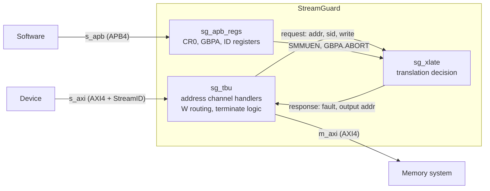

# StreamGuard architecture

## 1. What it does

A device that can issue its own memory accesses (a DMA-capable accelerator,
for example) is a risk: a wrong or malicious address reaches any memory on the
bus. StreamGuard is placed in-line on the device's AXI4 link. Each access is
tagged with a StreamID identifying the device. StreamGuard looks up that
stream's configuration, translates the address through that stream's page
tables, checks permissions, and either forwards the access with the translated
address or terminates it and records a fault.

This is the job of a System MMU. StreamGuard follows the public Arm SMMUv3
architecture specification (IHI 0070) for its programming model so that the
concepts carry over, and implements a deliberately small subset.

## 2. Block diagram

The split mirrors how production SMMUs are organised: a translation buffer
unit in the data path, and control logic that owns the configuration and
answers translation requests. In later milestones `sg_xlate` grows into that
control unit (stream table lookup, TLB, page table walker, queues) and gains
its own AXI port for reading tables from memory.

## 3. Interfaces

| Port group | Protocol | Direction | Purpose |
|---|---|---|---|
| `s_axi_*` | AXI4, plus `awsid`/`arsid` | from device | accesses to be policed |
| `m_axi_*` | AXI4 | to memory | forwarded accesses |
| `s_apb_*` | APB4, 17-bit address | from software | registers |

Parameters: `ADDR_W` (48), `DATA_W` (64), `ID_W` (4), `SID_W` (8).
Reset is active low, asserted asynchronously.

## 4. Behaviour in milestone 1

| SMMUEN | GBPA.ABORT | Result |
|---|---|---|
| 0 | 0 | bypass: address and all AXI attributes forwarded unchanged |
| 0 | 1 | terminate: SLVERR to the device, nothing reaches downstream |
| 1 | x | terminate (translation logic not present yet) |

### 4.1 Address channels

`sg_addr_chan` handles one request at a time: accept, ask for a decision, then
forward downstream or hand to the terminate logic. AW and AR share the single
translation port through a round robin arbiter.

### 4.2 Write data

AXI4 allows W beats to arrive before their AW. W therefore cannot be passed
straight through, because the decision for that burst may not exist yet. Each
AW decision is pushed into a small queue. A W burst is consumed only when its
decision is at the head: forwarded for a pass, dropped for a terminate.

### 4.3 Terminate and response ordering

AXI requires responses with the same ID to return in the order the requests
were issued. A locally generated error response is ready immediately, so it
could overtake the response of an earlier transaction with the same ID that
is still in flight downstream.

StreamGuard avoids this without tracking IDs. A terminated transaction

1. blocks new requests on its channel until its response has been sent, and
2. sends its response only when nothing is outstanding downstream.

Because of (1) nothing younger can exist, and because of (2) nothing older is
still pending, so the error response is always in order. The cost is
throughput while a termination is in progress, which is acceptable because
terminations are the exception.

## 5. Register map

Offsets follow the SMMUv3 register map (IHI 0070, chapter 6). Unlisted offsets
read as zero and ignore writes.

| Offset | Name | Access | Implemented fields |
|---|---|---|---|
| 0x0000 | IDR0 | RO | S1P, TTF, TTENDIAN, STALL_MODEL, ST_LEVEL |
| 0x0004 | IDR1 | RO | SIDSIZE, EVENTQS, CMDQS |
| 0x0014 | IDR5 | RO | OAS, GRAN4K |
| 0x0020 | CR0 | RW | SMMUEN [0], EVENTQEN [2], CMDQEN [3] |
| 0x0024 | CR0ACK | RO | mirrors CR0 one cycle later |
| 0x0044 | GBPA | RW | ABORT [20], UPDATE [31] |

GBPA is only changed by a write that sets UPDATE. UPDATE reads as 1 until the
new value is in effect.

Planned: STRTAB_BASE (0x0080), STRTAB_BASE_CFG (0x0088), CMDQ_BASE/PROD/CONS
(0x0090/0x0098/0x009C), EVENTQ_BASE (0x00A0), EVENTQ_PROD/CONS
(0x100A8/0x100AC), GERROR (0x0060), IRQ_CTRL (0x0050).

### Spec cross-check

Each field encoding is checked against the specification text before it is
relied on by a later milestone.

| Item | Spec reference | Checked |
|---|---|---|
| Register offsets above | ch. 6, register map | pending |
| IDR0 / IDR1 / IDR5 field positions and encodings | ch. 6 | pending |
| CR0 / CR0ACK update procedure | ch. 6 | pending |
| GBPA UPDATE procedure, effect only while SMMUEN = 0 | ch. 6 | pending |

## 6. Design decisions

| # | Decision | Reason |
|---|---|---|
| D1 | Enabled without translation logic terminates everything | Fail closed: if an access cannot be shown to be allowed it is not forwarded |
| D2 | Terminated transactions get SLVERR, read data zero | The device must see a completed transaction with an error, and no stale data |
| D3 | Ordering by blocking instead of per-ID tracking | Small and easy to reason about; see 4.3 |
| D4 | One address request in flight per channel | Correct first. A TLB-hit fast path is a later optimisation with a measurable baseline |
| D5 | Datapath acts on CR0ACK, not CR0 | What software reads back as acknowledged is what the hardware is doing |
| D6 | APB for registers | Low-speed configuration bus, as used for the programming interface of system IP |

## 7. Scope

Planned for this project: stage 1 translation, AArch64 table format, 4 KB
granule with 2 MB and 1 GB blocks, linear stream table, one context
descriptor per stream, ASID-tagged TLB, command queue with invalidation and
sync commands, event queue with translation, permission and bad-StreamID
faults.

Out of scope: stage 2 and nested translation, Secure state, SubstreamIDs,
two-level stream tables, 16 KB and 64 KB granules, stall fault model, PCIe
ATS and PRI, MSIs, hardware access/dirty flag update, broadcast TLB
maintenance.
