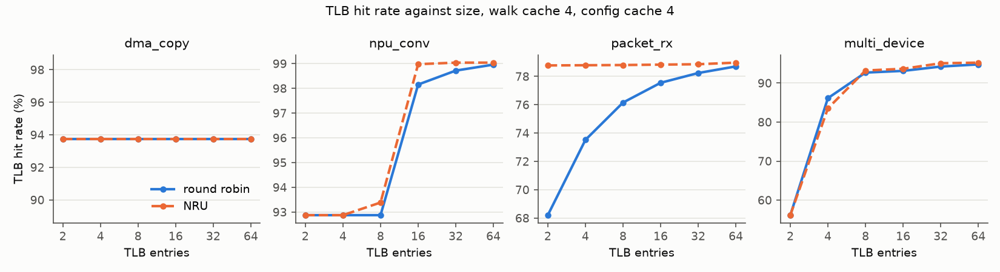
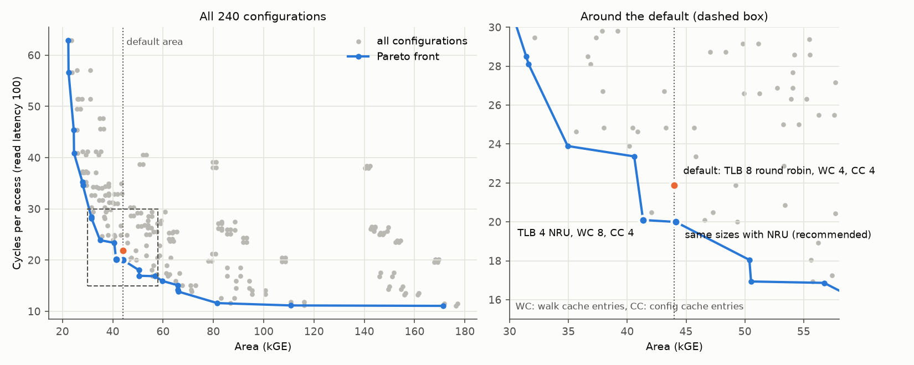

# StreamGuard TLB sizing study

How big should the TLB, walk cache and configuration cache be, and which
TLB replacement policy should be used? Milestone 3 picked 8 / 4 / 4 entries
with round robin without data. This study measures the choice.

Everything here is produced by `make study` (`study/run_study.py`); the
full results for all 240 configurations are in
[sizing_sweep.csv](sizing_sweep.csv) (`score_rN`: the score at a table read
latency of N cycles; `<workload>_cycles_r100`: average cycles per access).

## Summary

- At a table read latency of 100 cycles, the default configuration
  (TLB 8 round robin, walk cache 4, config cache 4) spends **21.9 cycles per access** on translation
  (geometric mean over the four main workloads), for **44.0 kGE**.
- **Keeping the sizes and switching the TLB to NRU** brings that to **20.0** (-9%),
  for 5 more flip-flops. No workload gets slower:

  | Workload | TLB 8 round robin, walk cache 4, config cache 4 | TLB 8 NRU, walk cache 4, config cache 4 |
  |---|---|---|
  | dma_copy | 10.8 | 10.8 (+0%) |
  | npu_conv | 11.6 | 11.1 (-5%) |
  | packet_rx | 89.5 | 76.8 (-14%) |
  | multi_device | 20.3 | 17.3 (-14%) |
  | **score** | **21.9** | **20.0** |
  | area | 44.0 kGE | 44.1 kGE |

- The best configuration within the default's area estimate is TLB 4 NRU, walk cache 8, config cache 4
  (20.1). It scores about the same as the policy change, but by
  giving up TLB entries for walk cache entries: packet_rx gains much more,
  multi_device loses. Area estimates are only good to about 10% (section 3), so
  these two are a tie on area too.

  | Workload | TLB 8 round robin, walk cache 4, config cache 4 | TLB 4 NRU, walk cache 8, config cache 4 |
  |---|---|---|
  | dma_copy | 10.8 | 10.8 (+0%) |
  | npu_conv | 11.6 | 11.6 (+0%) |
  | packet_rx | 89.5 | 59.5 (-34%) |
  | multi_device | 20.3 | 21.8 (+7%) |
  | **score** | **21.9** | **20.1** |
  | area | 44.0 kGE | 41.3 kGE |

- The smallest configuration within 5% of the best result found is TLB 16 NRU, walk cache 16, config cache 4,
  at 81.6 kGE and 11.6 cycles per access. The best result found
  is 11.1 cycles, for 171.3 kGE.
- Mapping the NPU's buffers with 2 MB blocks instead of 4 KB pages does more
  than any TLB size: with 4 entries the hit rate goes from 92.9% to 100.0%,
  where 64 entries of 4 KB pages reach 99.0%.
- The cache model used for the sweep was checked against the RTL: on every
  validation run the hardware's own hit counters, its table read count and its
  total translation time equal the model's exactly (section 2).

## 1. Method

1. **Workloads** (`study/workloads.py`): synthetic device traffic built from
   simple, documented rules, not recorded from real hardware.

   | Workload | Accesses | Pages touched | What it is |
   |---|---|---|---|
   | dma_copy | 4096 | 256 | DMA engine copying 512 KB: read a burst, write a burst |
   | npu_conv | 11172 | 107 | NPU, 3x3 convolution 56x56x64 -> 56x56x64, one output row at a time, 4 KB pages |
   | packet_rx | 7096 | 1353 | network device writing 1500 packets into buffers spread over 32 MB |
   | multi_device | 7525 | 337 | four devices sharing the unit, switching every 1 to 4 transactions |
   | npu_conv_2m (comparison only) | 11172 | 107 | the same NPU layer with every buffer mapped as 2 MB blocks |

2. **Cache model** (`study/cachemodel.py`): replays a workload through
   copies of the RTL's cache rules, about a thousand times faster than
   simulating the RTL.
3. **Latency**: translation time per access is a fixed overhead that depends
   on the lookup path, plus the time spent waiting for table reads. The
   overheads were measured on the RTL:

   | Path | Overhead (cycles) | Table reads |
   |---|---|---|
   | TLB hit | 4 | 0 |
   | walk cache hit (walk of 1 read) | 10 | 1 |
   | full walk of a 4 KB page (4 reads) | 22 | 4 |
   | configuration not cached | +9 | +2 |

   The ranking assumes each table read takes **100 cycles**, roughly
   a DRAM access seen from a unit running near 1 GHz. The testbench memory
   answers in 2. Section 6 shows how the answer changes with this number.
4. **Area** (`study/area.py`): every cache size synthesised with Yosys and
   counted in NAND2 gate-equivalents (GE); section 3.
5. **Score**: average translation cycles per access for each of the four
   main workloads, combined with the geometric mean, as benchmark suites
   do: a 10% change counts the same on every workload, so the slowest one
   (packet_rx) does not decide the result alone. Lower is better. With the
   arithmetic mean the same configuration comes out best, but its advantage
   looks almost three times larger.

## 2. Is the model right? Validation against the RTL

`make validate` builds the RTL in four cache configurations and replays
every workload through it, access by access, with all caches on. For each
run it compares the hardware's hit counters, its table reads and its total
translation time with the model's.

| Configuration | Extra read latency | Workloads | Accesses | Counters and reads | Translation cycles |
|---|---|---|---|---|---|
| TLB 16 NRU, walk cache 8, config cache 2 | 0 | 5 | 41061 | equal | equal |
| TLB 16 NRU, walk cache 8, config cache 2 | 20 | 5 | 41061 | equal | equal |
| TLB 2 NRU, walk cache 1, config cache 1 | 0 | 5 | 41061 | equal | equal |
| TLB 32 round robin, walk cache 16, config cache 8 | 0 | 5 | 41061 | equal | equal |
| TLB 8 round robin, walk cache 4, config cache 4 | 0 | 5 | 41061 | equal | equal |

In total 205305 accesses. Every lookup path
had the same overhead on every access, at both read latencies:

| Path | Overhead (cycles) |
|---|---|
| cfg cached, TLB hit | 4 |
| cfg cached, walk 1 read(s) | 10 |
| cfg cached, walk 3 read(s) | 18 |
| cfg cached, walk 4 read(s) | 22 |
| cfg fetched, TLB hit | 13 |
| cfg fetched, walk 1 read(s) | 19 |
| cfg fetched, walk 3 read(s) | 27 |
| cfg fetched, walk 4 read(s) | 31 |

What this does and does not show: the model reproduces the hardware's cache
behaviour and timing for these workloads and these configurations, exactly.
It does not show that the workloads are realistic, or that the timing holds
with a memory whose latency varies from read to read.

## 3. Area

Each cache synthesised on its own (Yosys, generic NAND/NOR/inverter gates and
flip-flops), converted to NAND2 gate-equivalents: NAND2 and NOR2 1.0,
inverter 0.67, flip-flop with reset 6.7, clock enable +2.3.
These ratios are typical of standard-cell libraries but belong to none in
particular: good for comparing configurations, not for predicting silicon.

| Entries | TLB, round robin | TLB, NRU | Walk cache | Config cache |
|---|---|---|---|---|
| 1 |  |  | 1.0 kGE (72 FF) | 0.7 kGE (63 FF) |
| 2 | 3.9 kGE (175 FF) | 4.0 kGE (176 FF) | 3.2 kGE (145 FF) | 2.0 kGE (127 FF) |
| 4 | 8.0 kGE (350 FF) | 7.3 kGE (352 FF) | 6.7 kGE (290 FF) | 4.1 kGE (254 FF) |
| 8 | 16.3 kGE (699 FF) | 16.5 kGE (704 FF) | 13.1 kGE (579 FF) | 9.4 kGE (507 FF) |
| 16 | 33.6 kGE (1396 FF) | 32.1 kGE (1408 FF) | 28.5 kGE (1156 FF) |  |
| 32 | 61.4 kGE (2789 FF) | 61.4 kGE (2816 FF) |  |  |
| 64 | 122.4 kGE (5574 FF) | 121.8 kGE (5632 FF) |  |  |

The rest of the unit is 16.8 kGE. A TLB entry costs about
1.9 kGE: 36 bits of virtual tag, 36 of physical
address, ASID, level, permissions, and a comparator. The NRU policy adds one
flip-flop per entry; the difference is smaller than the variation between
synthesis runs (the 4 and 16 entry NRU TLBs even come out smaller).

Configuration area = rest of the unit + the three caches. Checked against
synthesising the whole unit:

| Configuration | Whole unit synthesised | Sum of parts | Difference |
|---|---|---|---|
| TLB 2 NRU, walk cache 1, config cache 1 | 24.7 kGE | 22.4 kGE | -9.1% |
| TLB 16 NRU, walk cache 8, config cache 2 | 64.2 kGE | 64.0 kGE | -0.3% |
| TLB 32 round robin, walk cache 16, config cache 8 | 111.0 kGE | 116.0 kGE | +4.5% |

Flip-flop counts add up exactly; the gate counts differ by up to about 10%
because synthesis optimises across module boundaries differently in each run.
Area differences below 10% between configurations are not significant.

## 4. TLB size and replacement policy

TLB hit rate, walk cache 4 and configuration cache 4 entries:

| Entries | dma_copy RR | dma_copy NRU | npu_conv RR | npu_conv NRU | packet_rx RR | packet_rx NRU | multi_device RR | multi_device NRU |
|---|---|---|---|---|---|---|---|---|
| 2 | 93.8% | 93.8% | 92.9% | 92.9% | 68.2% | 78.8% | 56.1% | 56.1% |
| 4 | 93.8% | 93.8% | 92.9% | 92.9% | 73.5% | 78.8% | 86.1% | 83.5% |
| 8 | 93.8% | 93.8% | 92.9% | 93.4% | 76.2% | 78.8% | 92.7% | 93.2% |
| 16 | 93.8% | 93.8% | 98.2% | 99.0% | 77.6% | 78.8% | 93.1% | 93.7% |
| 32 | 93.8% | 93.8% | 98.7% | 99.0% | 78.2% | 78.9% | 94.2% | 95.1% |
| 64 | 93.8% | 93.8% | 99.0% | 99.0% | 78.7% | 79.0% | 94.8% | 95.2% |

What the table shows:

- **dma_copy** is 93.8% at every size: each 4 KB
  page is used for 16 bursts and never again, so the only misses are the
  first touch of each page. A bigger TLB cannot help a stream; only bigger
  pages or prefetching can.
- **npu_conv** jumps between 8 and 16 entries. Every output row re-reads all
  9 weight pages plus 3 or 4 input pages and an output page: about 14 pages in
  a loop. With 8 entries the loop does not fit and the weights miss every row;
  with 16 it fits. Neither policy can help a loop that is larger than the TLB.
- **packet_rx** is where the policy matters. Each packet lands on a new
  page, but the descriptor ring is used for every packet. Round robin evicts
  the ring's page in turn with everything else; NRU keeps it because it is
  hit constantly. With 2 entries NRU reaches 78.8% against 68.2%
  for round robin, more than round robin reaches with 32 entries (78.2%).
- **multi_device** needs about 8 entries for four devices; above that the
  misses are mostly first touches of the camera and USB buffers.

NRU is not always better. Over all 240 configurations and four workloads,
its worst result against round robin is +18% translation time, for
multi_device with TLB 4 NRU, walk cache 1, config cache 4. With only four entries for four devices taking
turns, a one-bit history is coarse: once every entry has been used the bits
are cleared and the choice falls to the lowest-numbered entry, which is the
likely reason. NRU loses somewhere only with 4 TLB entries;
with more it is equal or better on every workload and configuration.

## 5. Walk cache and configuration cache

A walk cache entry remembers where one 2 MB region's level 3 table is, so a
TLB miss in that region needs 1 table read instead of 4.

packet_rx, TLB 8 NRU, configuration cache 4, read latency 100:

| Walk cache entries | Walk cache hits per TLB miss | Table reads per 1000 accesses | Cycles per access |
|---|---|---|---|
| 1 | 6% | 809 | 88.5 |
| 2 | 12% | 769 | 84.4 |
| 4 | 24% | 695 | 76.8 |
| 8 | 50% | 530 | 59.6 |
| 16 | 95% | 241 | 29.5 |

The packet buffers are spread over 16 regions of 2 MB, so 16 walk cache
entries cover all of them and most TLB misses cost one read. Every
doubling helps on this workload; on dma_copy and npu_conv, whose buffers
sit in two 2 MB regions each, two entries are enough.

multi_device, TLB 8 NRU, walk cache 4, read latency 100:

| Config cache entries | Configuration misses per 1000 accesses | Cycles per access |
|---|---|---|
| 1 | 399 | 101.0 |
| 2 | 399 | 101.0 |
| 4 | 1 | 17.3 |
| 8 | 1 | 17.3 |

Four devices take turns. With fewer configuration entries than devices, round
robin replacement evicts each device's configuration just before it is
needed again, and every switch costs two extra table reads. One entry per
active device removes this completely; more do nothing.

## 6. How much does memory latency matter?

Average cycles per access for the default configuration and the best
configuration at the same area, at three table read latencies:

| Workload | default, 2 | default, 20 | default, 100 | best, 2 | best, 20 | best, 100 |
|---|---|---|---|---|---|---|
| dma_copy | 4.5 | 5.7 | 10.8 | 4.5 | 5.7 | 10.8 |
| npu_conv | 4.6 | 5.9 | 11.6 | 4.6 | 5.9 | 11.6 |
| packet_rx | 9.4 | 24.1 | 89.5 | 7.6 | 17.1 | 59.5 |
| multi_device | 5.1 | 7.9 | 20.3 | 5.3 | 8.4 | 21.8 |
| npu_conv_2m | 4.0 | 4.0 | 4.1 | 4.0 | 4.0 | 4.1 |

With a 2-cycle memory a miss costs little: no workload averages more than
9.4 cycles per access. At DRAM-like latency the misses dominate, and
packet_rx in particular spends most of its translation time waiting for table
reads. The best configuration within the default area at other latencies:

- at 20 cycles the best within the default area is TLB 4 NRU, walk cache 8, config cache 4 (the same).
- at 2 cycles the best within the default area is TLB 4 NRU, walk cache 8, config cache 4 (the same).

## 7. Area against performance

Every point is one configuration. The blue line joins the configurations
that no other configuration beats on both area and time (the Pareto front):

| Configuration | Area (kGE) | Cycles per access |
|---|---|---|
| TLB 2 round robin, walk cache 1, config cache 1 | 22.3 | 62.9 |
| TLB 2 NRU, walk cache 1, config cache 1 | 22.4 | 56.7 |
| TLB 2 round robin, walk cache 2, config cache 1 | 24.5 | 45.4 |
| TLB 2 NRU, walk cache 2, config cache 1 | 24.6 | 40.9 |
| TLB 4 NRU, walk cache 2, config cache 1 | 27.9 | 35.3 |
| TLB 2 NRU, walk cache 4, config cache 1 | 28.1 | 34.6 |
| TLB 4 NRU, walk cache 2, config cache 4 | 31.4 | 28.5 |
| TLB 2 NRU, walk cache 4, config cache 4 | 31.6 | 28.1 |
| TLB 4 NRU, walk cache 4, config cache 4 | 34.9 | 23.9 |
| TLB 8 NRU, walk cache 2, config cache 4 | 40.6 | 23.4 |
| TLB 4 NRU, walk cache 8, config cache 4 | 41.3 | 20.1 |
| TLB 8 NRU, walk cache 4, config cache 4 | 44.1 | 20.0 |
| TLB 8 round robin, walk cache 8, config cache 4 | 50.4 | 18.0 |
| TLB 8 NRU, walk cache 8, config cache 4 | 50.5 | 16.9 |
| TLB 4 NRU, walk cache 16, config cache 4 | 56.7 | 16.9 |
| TLB 16 NRU, walk cache 4, config cache 4 | 59.8 | 15.9 |
| TLB 8 round robin, walk cache 16, config cache 4 | 65.8 | 15.1 |
| TLB 8 NRU, walk cache 16, config cache 4 | 65.9 | 14.2 |
| TLB 16 NRU, walk cache 8, config cache 4 | 66.2 | 13.8 |
| TLB 16 NRU, walk cache 16, config cache 4 | 81.6 | 11.6 |
| TLB 32 NRU, walk cache 16, config cache 4 | 110.8 | 11.2 |
| TLB 64 NRU, walk cache 16, config cache 4 | 171.3 | 11.1 |

The default configuration is not on the front.
Within its area (44.0 kGE) the best choice is TLB 4 NRU, walk cache 8, config cache 4.

Recommendation, for these workloads and assumptions:

- **Switch the TLB to NRU and keep the sizes** (TLB 8 NRU, walk cache 4, config cache 4). It is 9% better
  overall, no workload gets slower, and it costs 5 flip-flops.
- If network-like traffic matters most, TLB 4 NRU, walk cache 8, config cache 4 is the alternative at the
  same area: much better for packet_rx, worse when many devices share the unit.
- With NRU, keep more than 4 TLB entries: at 4 it can lose to round robin.
- Give the configuration cache one entry per active device; more do nothing.
- If software can map device buffers with **2 MB blocks**, a much smaller
  TLB is enough.

## 8. Searching instead of trying everything

With a model that evaluates a configuration in a fraction of a second, all
240 can simply be tried, and that is what the results above come from. In a
real flow each candidate would be checked by simulating and synthesising the
RTL, which here takes about a minute per configuration, and the space would
be larger (associativity, separate TLBs per page size, more policies). Then
the number of evaluations matters.

The exhaustive result gives the true optimum, so search methods can be
measured against it. The task: best score within the default's area, with
30 evaluations (one eighth of the space), 30 runs per method.

| Method | Runs that found the optimum | Median gap to optimum | Worst gap |
|---|---|---|---|
| genetic algorithm | 12 of 30 | 5.4% | 33.0% |
| random search | 6 of 30 | 18.9% | 69.6% |

The genetic algorithm is the same design as in
[FlashFit](https://github.com/morom46/flashfit): tournament
selection, uniform crossover, per-gene mutation, one elite, population 8.
It was not tuned for this problem. With a space this small the honest
conclusion is that exhaustive search is the right tool here; the comparison
shows how the methods would trade evaluations for certainty if it were not.

## 9. Limits

- The workloads are synthetic. Their locality is chosen to resemble real
  devices, but no real trace was used. A different mix would change the
  weights of the conclusions, though the mechanisms (streams cannot be helped
  by capacity, loops need to fit, a hot page needs a policy that sees use)
  hold generally.
- One access at a time. The RTL handles one translation at a time, so the
  study measures latency per access; it says nothing about throughput with
  several requests in flight, which the RTL does not support.
- The read latency is a single number. Real memory latency varies, and
  table reads may hit in a system cache.
- Area is a gate-equivalent estimate from generic gates and flip-flops,
  without timing constraints, placement or a real cell library.
- Only fully associative caches and two policies were studied.

